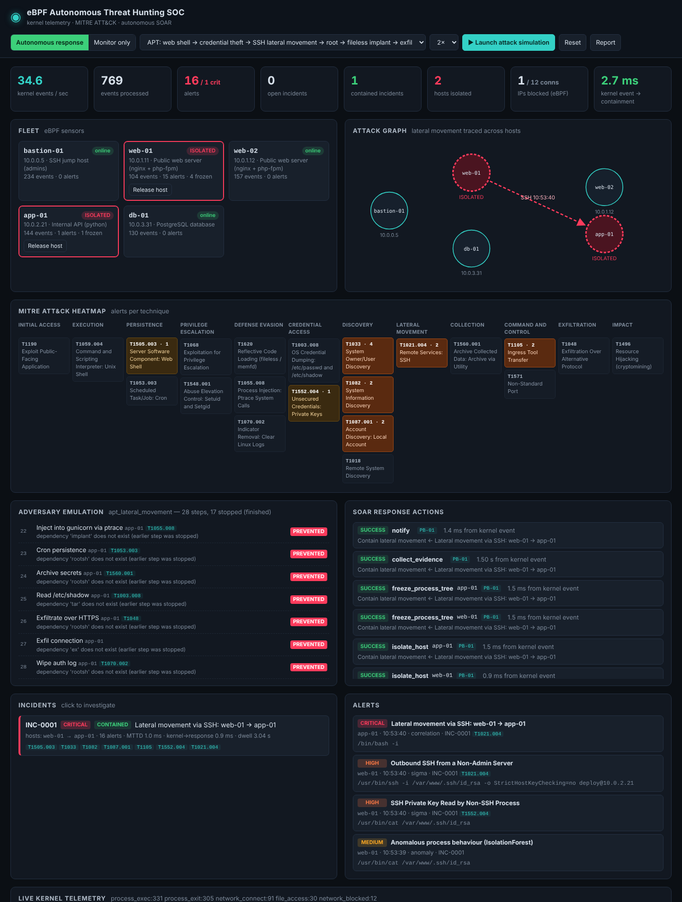
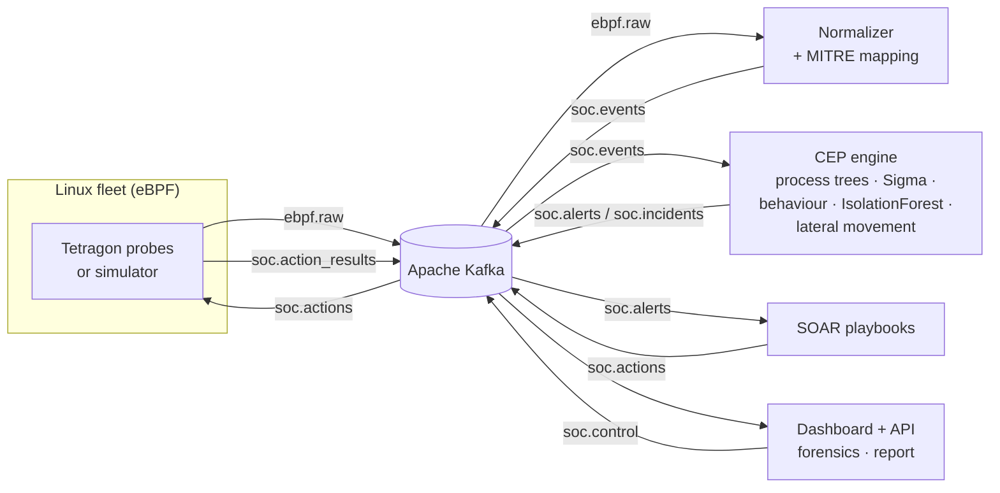

# eBPF-Powered Autonomous Threat Hunting SOC

A working, demonstrable Security Operations Center pipeline that turns **kernel-level eBPF telemetry**
into **MITRE ATT&CK-mapped detections**, **traces lateral movement across hosts**, and **autonomously
contains attacks** (freezes process trees, isolates hosts, blocks IPs). Everything is visible on a
live investigation dashboard.



> **Runs on Windows.** eBPF needs a Linux kernel, so by default the project uses a **sensor simulator**
> that emits the *exact JSON format of Cilium Tetragon* for a fleet of 5 virtual Linux servers.
> The same pipeline consumes **real Tetragon eBPF events** on a Linux machine (see
> [Live eBPF mode](docs/LIVE_EBPF_MODE.md)).

---

## What it does

| Capability | Implementation |
|---|---|
| Kernel telemetry (eBPF) | Tetragon `process_exec` / `process_exit` / `process_kprobe` (tcp_connect, commit_creds, ptrace, memfd_create, security_file_permission). TracingPolicies in `deploy/tetragon/policies/`. Simulator emits the identical schema. |
| High-throughput streaming | **Apache Kafka** (KRaft) with 7 topics; ~20k events/s per engine core, horizontally scalable via consumer groups. |
| Syscall → ATT&CK schema | Declarative mapping `config/mitre_mapping.yml` (21 techniques, 12 tactics). |
| Complex Event Processing | `soc/detector.py` rebuilds **process execution trees** from disjoint kernel events, finds the attack root, groups alerts into incidents. |
| Lateral movement tracing | Joins `tcp_connect(:22)` on host A with `sshd → shell` on host B and **links the process trees across hosts** into one incident. |
| Threat hunting rules | **15 Sigma rules** (`rules/sigma/`) run by a built-in Sigma engine (modifiers, `1 of`, `not`, …). |
| Behavioural detection | Fileless malware (memfd_create → exec from memory), ptrace memory injection, privilege escalation outside sudo/su. |
| Anomaly detection (ML) | **IsolationForest** trained on a benign baseline (parent/child rarity, path, uid class, arg entropy, depth, spawn burst). |
| SOAR | 5 YAML playbooks (`playbooks/`): freeze / kill process tree, isolate host, eBPF IP blocklist, evidence collection, webhook (n8n/Slack). Autonomous, monitor-only and analyst-approval modes. |
| Forensics | Automatic evidence bundle per incident: forensic timeline (JSON + Markdown), process trees, IOCs → `evidence/INC-xxxx/`. |
| Adversary emulation | 3 Caldera-style scenarios (`scenarios/`): APT with SSH lateral movement, fileless cryptominer, insider privilege escalation. |
| Dashboard | MITRE heatmap, fleet status, attack graph, process trees, alerts, SOAR actions, live telemetry, report. |

### Measured results (from `python -m soc.report`)

| Scenario | Response off | Autonomous response | Time from first attacker action to containment |
|---|---|---|---|
| APT: web shell → SSH lateral movement → root → fileless → exfil | 28/28 steps succeed | **stopped at the lateral-movement step**, 17 steps prevented | ≈ 2.3 s |
| Fileless cryptominer | 10/10 | miner killed, pool IP blocked, 4 steps prevented | ≈ 1.0 s |
| Insider pkexec privilege escalation | 13/13 | session frozen + host isolated, 7 steps prevented | ≈ 0.8 s |

Kernel event → containment action latency is a few milliseconds. The full report is
[docs/THREAT_HUNTING_REPORT.md](docs/THREAT_HUNTING_REPORT.md).

---

## Architecture



Details: [docs/ARCHITECTURE.md](docs/ARCHITECTURE.md) · Detection engineering:
[docs/DETECTION_ENGINEERING.md](docs/DETECTION_ENGINEERING.md)

---

## Quick start on Windows

Full step-by-step guide with screenshots-level detail and troubleshooting:
**[docs/WINDOWS_SETUP.md](docs/WINDOWS_SETUP.md)**

### Option A — Docker Desktop (full stack with Kafka)

```powershell
git clone https://github.com/<your-username>/ebpf-threat-hunting-soc.git
cd ebpf-threat-hunting-soc
docker compose up --build
```
Open **http://localhost:8080** (first build takes 3–5 minutes). Stop with `Ctrl+C`, then `docker compose down`.

### Option B — Python only (no Docker)

```powershell
python -m venv .venv
.venv\Scripts\activate
pip install -r requirements.txt
python -m soc.run_all
```
Open **http://localhost:8080**. Or simply double-click `scripts\windows\run-local.bat`.

### Demo in 60 seconds

1. Watch benign background activity stream in (cron jobs, health checks, admin SSH from the bastion…) — **no alerts**.
2. Pick **"APT: web shell → … → exfil"** and click **▶ Launch attack simulation**.
3. Watch the kill chain: web-shell, discovery, payload download (C2 IP blocked), SSH key theft, then the
   **SSH pivot web-01 → app-01**. The CEP engine links the two process trees, PB-01 **isolates both hosts and freezes
   the attacker's processes**, and every remaining step shows **PREVENTED**.
4. Click the incident to see cross-host process trees, the forensic timeline and IOCs; download the timeline.
5. Click **Reset**, switch to **Monitor only**, and run it again to see the full kill chain light up the MITRE heatmap.
6. Click **Report** for the generated threat-hunting report.

---

## Project structure

```
soc/
  simulator.py        eBPF fleet simulator (Tetragon JSON) + adversary emulation + response enforcement
  tetragon_sensor.py  LIVE mode: tail real Tetragon output, execute actions on the host
  normalizer.py       raw Tetragon events -> normalised schema
  mitre.py            syscall/event -> ATT&CK translation engine
  sigma.py            Sigma rule engine
  process_tree.py     process execution trees from disjoint kernel events
  anomaly.py          behavioural sequence detectors + IsolationForest model
  detector.py         CEP engine: detections, lateral-movement correlation, incidents
  soar.py             playbook engine
  forensics.py        evidence collection / forensic timeline
  dashboard.py        state aggregation + FastAPI REST API
  report.py           threat-intelligence engineering report
  bus.py              Kafka / in-memory message bus
  run_all.py          all services in one process
  service.py          container entrypoint (sensor | engine | dashboard)
  web/                dashboard UI (HTML/CSS/JS, no build step)
config/               fleet + MITRE mapping schema
rules/sigma/          15 Sigma threat-hunting rules
playbooks/            5 SOAR playbooks
scenarios/            3 adversary emulation scenarios
deploy/tetragon/      Tetragon TracingPolicies for live mode
tests/                19 pytest tests (unit + end-to-end)
scripts/              benchmark, docker e2e test, Windows .bat helpers
docs/                 architecture, setup, detection engineering, report
```

## Project plan coverage

| Week | Brief | Where |
|---|---|---|
| 1 | eBPF probes (Tetragon/Falco) for syscalls, exec, sockets | `deploy/tetragon/policies`, `soc/tetragon_sensor.py`, `soc/simulator.py` |
| 1 | Kafka streaming + normalisation | `docker-compose.yml`, `soc/bus.py`, `soc/normalizer.py` |
| 1 | Syscall → MITRE ATT&CK schema | `config/mitre_mapping.yml`, `soc/mitre.py` |
| 2 | Python CEP engine, process execution trees | `soc/detector.py`, `soc/process_tree.py` |
| 2 | Fileless / memory injection / privilege escalation detection | `soc/anomaly.py` (behaviour + IsolationForest) |
| 2 | Sigma threat-hunting rules | `rules/sigma/`, `soc/sigma.py` |
| 3 | SOAR module (n8n/Cortex-style) | `soc/soar.py`, `playbooks/`, `SOAR_WEBHOOK_URL` for n8n |
| 3 | eBPF remediation: drop packets / freeze process trees | simulator enforcement; live: Tetragon `Sigkill` policy + SIGSTOP + nftables |
| 3 | Forensic timeline of lateral movement | `soc/forensics.py`, `evidence/` |
| 4 | SOC dashboard with telemetry + MITRE heatmap | `soc/dashboard.py`, `soc/web/` |
| 4 | Adversary simulation, response times | `scenarios/`, `python -m soc.report` |
| 4 | Threat intelligence engineering report | `docs/THREAT_HUNTING_REPORT.md` |

## Configuration

| Variable | Default | Meaning |
|---|---|---|
| `SOC_BUS` | `memory` | `memory` (single process) or `kafka` |
| `KAFKA_BOOTSTRAP` | `localhost:9092` | Kafka brokers |
| `SENSOR_MODE` | `simulate` | `simulate` or `tetragon` |
| `BACKGROUND_EPS` | `25` | benign simulated events per second |
| `RESPONSE_MODE` | `autonomous` | `autonomous` or `monitor` |
| `SOAR_WEBHOOK_URL` | – | n8n / Slack / Teams webhook for notifications |
| `LIVE_RESPONDER_DRY_RUN` | `true` | live mode: log response commands instead of running them |
| `DASHBOARD_PORT` | `8080` | dashboard port |

## Tests and benchmark

```powershell
pip install -r requirements-dev.txt
python -m pytest            # 19 tests: normalizer, Sigma, CEP, lateral movement, SOAR, API, end-to-end
python scripts\benchmark.py # pipeline throughput
python -m soc.report        # replays all scenarios and regenerates docs/THREAT_HUNTING_REPORT.md
```
GitHub Actions (`.github/workflows/ci.yml`) runs the tests on Ubuntu + Windows and an end-to-end test of the
full Docker/Kafka stack.

## Scope and limitations

This is a practical, demonstrable version rather than an enterprise deployment:
- On Windows the eBPF sensors are **simulated** (same event format as Tetragon). Real eBPF runs only in
  [Live mode](docs/LIVE_EBPF_MODE.md) on Linux.
- Live-mode remediation defaults to **dry-run**; isolation uses nftables and IP blocking uses a Tetragon
  `Sigkill` TracingPolicy, both on the single host where the sensor runs.
- The dashboard is custom (FastAPI + vanilla JS) instead of Kibana/Grafana to keep the stack light on a laptop;
  all data is also on Kafka topics for Elasticsearch/Grafana ingestion.
- State is in memory; restarting the dashboard clears it.

## License

MIT
